

  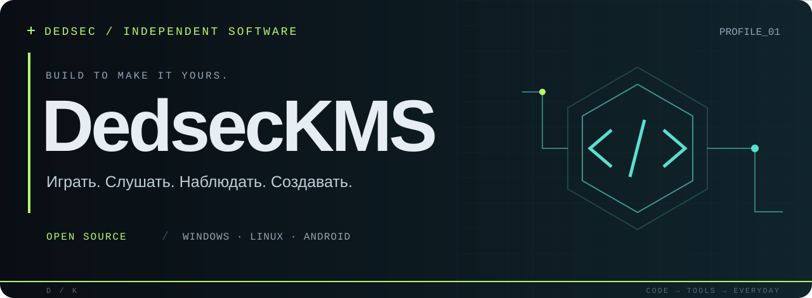

  <strong>Привет, я DedsecKMS.</strong> Создаю приложения под брендом <strong>Dedsec</strong>. 
  Игры с друзьями, своя музыка, контроль системы и локальный AI — у каждой идеи свой инструмент.

  <a href="https://github.com/Dedseckms/MineDed">Играть</a> &nbsp; / &nbsp;
  <a href="https://github.com/Dedseckms/Dedsec-Music">Слушать</a> &nbsp; / &nbsp;
  <a href="https://github.com/Dedseckms/Dedsec-Monitor">Наблюдать</a> &nbsp; / &nbsp;
  <a href="https://github.com/Dedseckms/DedsecAI-Studio">Создавать</a>

<picture>
  <source media="(prefers-reduced-motion: reduce)" srcset="assets/signal.png">
  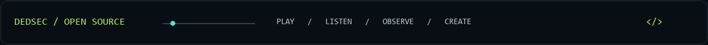
</picture>

### `~/dedsec` &nbsp; Из идеи — в приложение

<table>
<tr>
<td width="50%" valign="top">

<a href="https://github.com/Dedseckms/MineDed">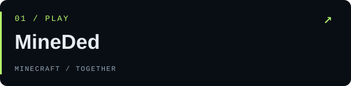</a>

**Minecraft начинается с друзей.**

Лаунчер с модами и сборками, своими скинами, P2P-мультиплеером и голосовым чатом.

<a href="https://github.com/Dedseckms/MineDed">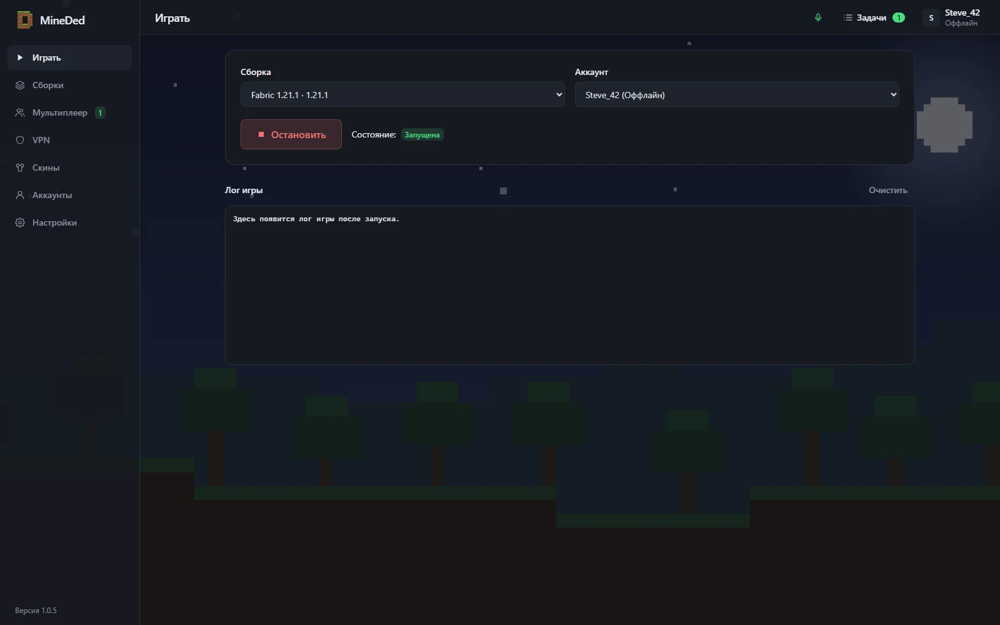</a>

`Windows · Linux` &nbsp; `Rust · Tauri · React`

[**Код ↗**](https://github.com/Dedseckms/MineDed) · [Скачать](https://github.com/Dedseckms/MineDed/releases/latest) · [Сайт](https://mineded.dedseckms.ru)

</td>
<td width="50%" valign="top">

<a href="https://github.com/Dedseckms/Dedsec-Music">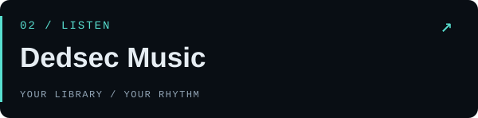</a>

**Своя библиотека. Свой ритм.**

Клиенты собственного Navidrome-сервера: музыка, личные плейлисты, тексты и офлайн.

<a href="https://github.com/Dedseckms/Dedsec-Music">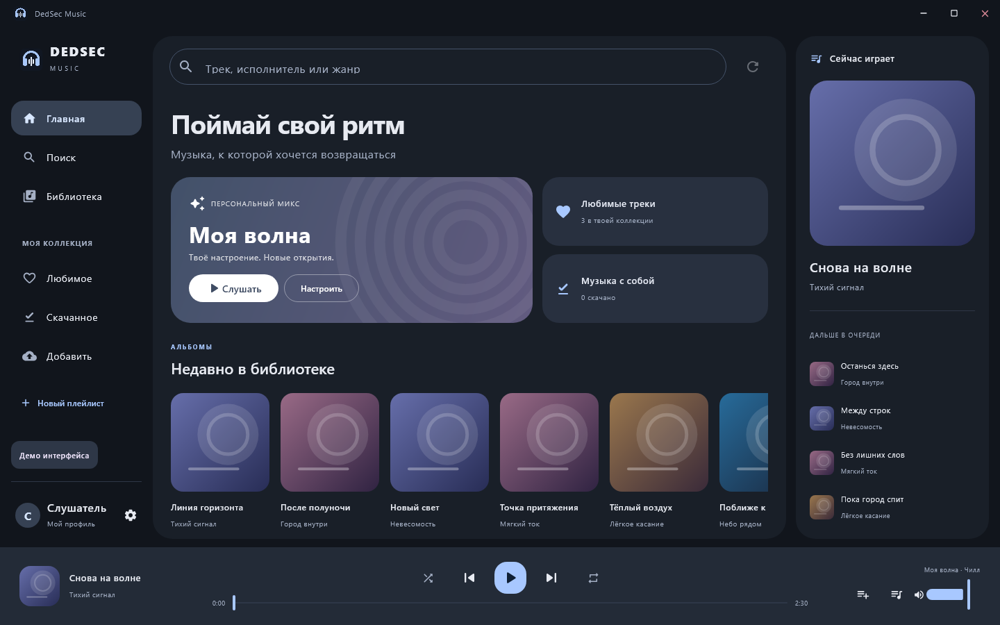</a>

`Android · Windows` &nbsp; `Kotlin · Compose`

[**Код ↗**](https://github.com/Dedseckms/Dedsec-Music) · [Скачать](https://github.com/Dedseckms/Dedsec-Music/releases/latest) · [Свой сервер](https://github.com/Dedseckms/Dedsec-Music/tree/main/server)

</td>
</tr>
<tr>
<td width="50%" valign="top">

<a href="https://github.com/Dedseckms/Dedsec-Monitor">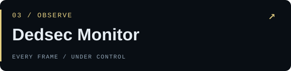</a>

**Каждый кадр — под контролем.**

FPS, датчики CPU/GPU, живые графики, игровой оверлей и запись сессий в CSV.

<a href="https://github.com/Dedseckms/Dedsec-Monitor">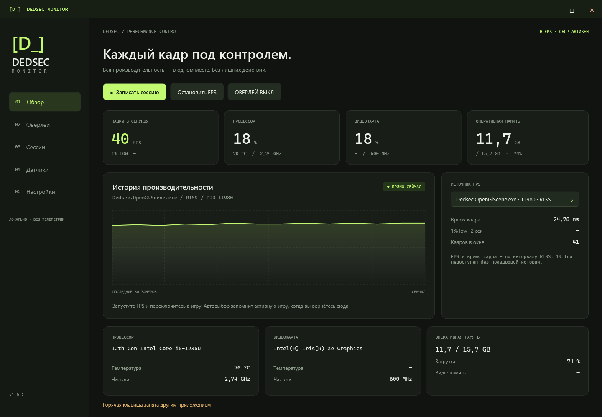</a>

`Windows` &nbsp; `C# · .NET`

[**Код ↗**](https://github.com/Dedseckms/Dedsec-Monitor) · [Скачать](https://github.com/Dedseckms/Dedsec-Monitor/releases/latest) · [Совместимость](https://github.com/Dedseckms/Dedsec-Monitor#совместимость)

</td>
<td width="50%" valign="top">

<a href="https://github.com/Dedseckms/DedsecAI-Studio">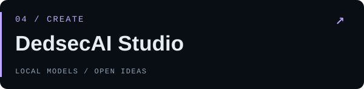</a>

**Локальные модели. Своя мастерская.**

AI-чат с памятью, работа с кодом через Pi и генерация изображений. Ранняя версия.

<a href="https://github.com/Dedseckms/DedsecAI-Studio">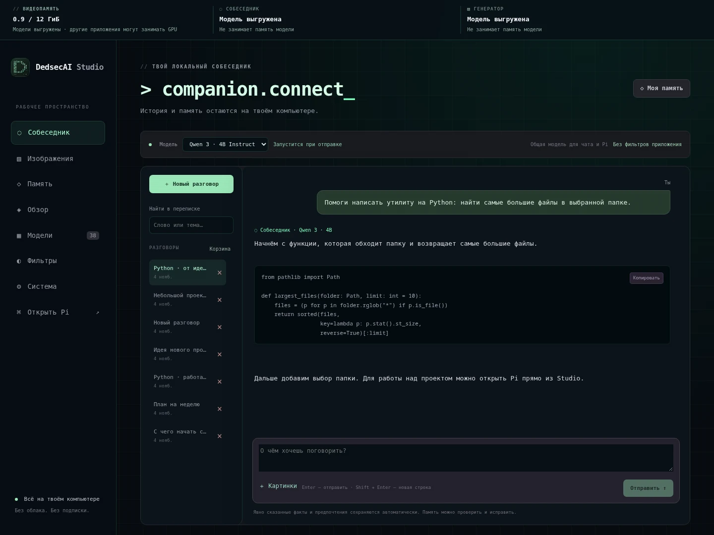</a>

`Windows · Arch · Debian` &nbsp; `Python · llama.cpp`

[**Код ↗**](https://github.com/Dedseckms/DedsecAI-Studio) · [Скачать](https://github.com/Dedseckms/DedsecAI-Studio/releases/latest) · [Руководство](https://github.com/Dedseckms/DedsecAI-Studio#guide)

</td>
</tr>
</table>

### `cat stack` &nbsp; Инструменты мастерской

| Приложения | Интерфейсы | Под капотом |
| :-- | :-- | :-- |
| Rust · Kotlin · C# · Python | React · Tauri · Jetpack Compose | Linux · Docker · Navidrome · llama.cpp |

  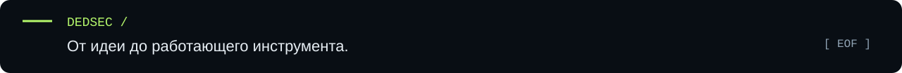
  Исходники, инструкции и релизы — в репозиториях выше. 
  Превью взяты из самих проектов; Music и AI Studio показывают демонстрационные данные. 
  <a href="assets/signal.png">Статичная версия анимации</a> · <a href="assets/sources.json">Источники скриншотов</a>

